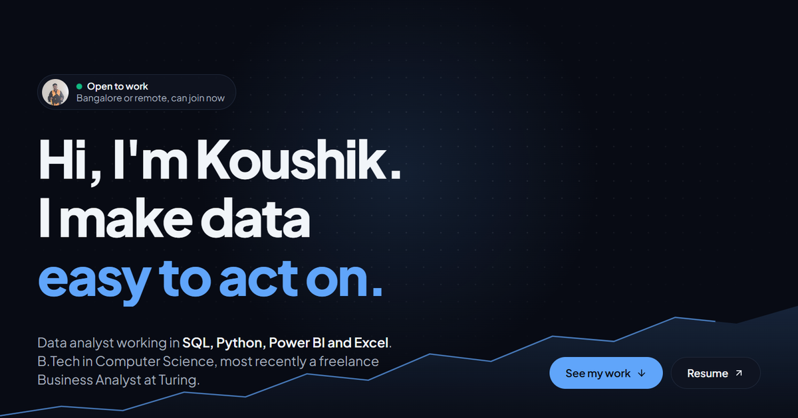

# Koushik Maity | Portfolio



My personal portfolio site: [koushikmaity.netlify.app](https://koushikmaity.netlify.app/). It has my data analytics projects, skills, work experience and certificates, with a light and dark mode.

Built with React, Tailwind CSS and React Router, with AOS for scroll animations. Hosted on Netlify.

## Run it locally

```
git clone https://github.com/koushikxy/koushikMaity.git
cd koushikMaity
npm install
npm start
```

The site opens at http://localhost:3000.

---

Koushik Maity · [LinkedIn](https://www.linkedin.com/in/ksmaity/) · [GitHub](https://github.com/koushikxy)
